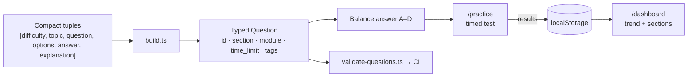

<h1 align="center">AptIQ — Placement Aptitude Practice</h1>

<p align="center"><b>Timed MCQ practice for campus placements across Quantitative, Logical and Verbal sections, with instant explanations and a progress dashboard.</b></p>

<p align="center">
  
  
  
  
  
  
</p>

<p align="center">
  <a href="https://mcq-r6wr.vercel.app"><b>🚀 Live Demo</b></a> ·
  <a href="#-screenshots">Screenshots</a> ·
  <a href="#-demo-video">Demo Video</a> ·
  <a href="#-getting-started">Getting Started</a>
</p>

---

## 📖 Table of Contents

- [About](#-about)
- [Features](#-features)
- [Screenshots](#-screenshots)
- [Demo Video](#-demo-video)
- [Tech Stack](#-tech-stack)
- [Getting Started](#-getting-started)
- [Available Scripts](#-available-scripts)
- [Project Structure](#-project-structure)
- [How It Works](#-how-it-works)
- [Question Bank](#-question-bank)
- [Adding Questions](#-adding-questions)
- [Deployment](#-deployment)
- [Roadmap](#-roadmap)
- [Contributing](#-contributing)
- [License](#-license)

---

## 💡 About

**AptIQ** helps engineering students prepare for placement aptitude rounds. Pick a section, take a timed test, and get a score with a worked explanation for every question. Results are saved in the browser, and the dashboard shows your accuracy trend and weakest sections.

## ✨ Features

| | Feature | Details |
|---|---|---|
| 🧮 | **3 sections, 42 modules** | Quantitative Aptitude (19), Logical Reasoning (14), Verbal Ability (9) |
| 📚 | **210 hand-written questions** | 4 options each, with an explanation, difficulty level and tags |
| ⏱ | **Difficulty-based timers** | 45 s easy · 75 s medium · 120 s hard. Auto-submits when time runs out |
| 🎛 | **Custom tests** | Choose a section (or all) and a length of 5, 10 or 20 questions |
| 🎯 | **Instant results** | Score ring, total time, and a review of each answer (correct / wrong / skipped) |
| 📈 | **Progress dashboard** | Accuracy trend chart, accuracy by section, best score, recent tests table |
| 💾 | **No sign-up needed** | Results are kept in `localStorage`, with Supabase ready for accounts later |
| ✅ | **Question-bank validator** | Catches duplicate IDs or text, bad answer indexes and unknown modules |
| ⚖️ | **Balanced answer keys** | Correct answers are spread evenly across A–D |
| 📱 | **Responsive UI** | Clean Tailwind design that works on mobile, tablet and desktop |

## 📸 Screenshots

> Image files go in `docs/screenshots/`. To capture them, run `npm run dev` and take screenshots of each page.

| Home | Test setup |
|---|---|
|  |  |

| Timed question | Results & review |
|---|---|
|  |  |

| Dashboard |
|---|
|  |

## 🎬 Demo Video

> Add the recording as `docs/demo.mp4`, or drag the video into a GitHub issue or PR comment and paste the generated link here.

https://github.com/nvaltryek-001/MCQ/raw/main/docs/demo.mp4

**Flow shown:** Home → choose section → answer timed questions → results & explanations → dashboard.

## 🛠 Tech Stack

| Layer | Technology |
|---|---|
| Framework | [Next.js 14](https://nextjs.org/) (App Router) |
| UI | React 18 + [Tailwind CSS 3](https://tailwindcss.com/) |
| Charts | [Recharts](https://recharts.org/) |
| Language | TypeScript (strict) |
| Data | Typed question bank in `src/data/questions/*.ts` |
| Storage | Browser `localStorage` (Supabase client included for future auth/sync) |
| Tooling | `tsx` validator, Vitest, PostCSS, Autoprefixer |
| Hosting | Vercel |

## 🚀 Getting Started

### Prerequisites

- **Node.js 18.17+** (20 LTS recommended)
- **npm 9+**

### Installation

```bash
# 1. Clone
git clone https://github.com/nvaltryek-001/MCQ.git
cd MCQ

# 2. Install dependencies
npm install

# 3. (Optional) environment variables, only needed for Supabase features
cp .env.example .env.local

# 4. Validate the question bank
npm run validate

# 5. Start the dev server
npm run dev
```

Open **http://localhost:3000**.

### Environment variables

| Variable | Scope | Purpose |
|---|---|---|
| `NEXT_PUBLIC_SUPABASE_URL` | Browser | Supabase project URL |
| `NEXT_PUBLIC_SUPABASE_ANON_KEY` | Browser | Supabase anon key |
| `SUPABASE_SERVICE_ROLE_KEY` | **Server only** | For seeding scripts. Never expose it to the browser |

The app runs fully without these. The current pages use the bundled question bank.

## 📜 Available Scripts

| Command | Description |
|---|---|
| `npm run dev` | Start the development server on port 3000 |
| `npm run build` | Create a production build |
| `npm start` | Serve the production build |
| `npm run validate` | Validate all questions (IDs, answers, modules, duplicates) |
| `npm test` | Run unit tests with Vitest |
| `npm run lint` | Lint with Next.js ESLint config |

## 📁 Project Structure

```text
MCQ/
├── src/
│   ├── app/
│   │   ├── layout.tsx          # Root layout, nav bar & footer
│   │   ├── globals.css         # Tailwind + design tokens / components
│   │   ├── page.tsx            # Landing page
│   │   ├── practice/page.tsx   # Test setup → timed test → results
│   │   └── dashboard/page.tsx  # Stats, trend chart, section breakdown
│   ├── data/questions/
│   │   ├── quantitative.ts     # 95 questions
│   │   ├── logical.ts          # 70 questions
│   │   ├── verbal.ts           # 45 questions
│   │   ├── build.ts            # Compact tuple → typed Question
│   │   └── index.ts            # Merges + balances answer positions
│   └── lib/
│       ├── curriculum.ts       # Sections, modules, blueprints
│       ├── types.ts            # Question / Answer / Analysis types
│       └── config.ts           # Score bands & thresholds
├── scripts/validate-questions.ts
├── tailwind.config.ts
└── package.json
```

## ⚙️ How It Works



1. Questions are written as short tuples and expanded into typed `Question` objects with IDs, time limits and tags.
2. `/practice` shuffles the chosen pool and gives each question its own countdown.
3. When a test finishes, a summary (total, correct, time, per-section scores) is saved to `localStorage`.
4. `/dashboard` reads that history and draws the stats, trend chart and section bars.

## 📚 Question Bank

| Section | Modules | Questions |
|---|---|---|
| Quantitative Aptitude | 19 | 95 |
| Logical Reasoning | 14 | 70 |
| Verbal Ability | 9 | 45 |
| **Total** | **42** | **210** |

Difficulty mix: **30 % easy · 50 % medium · 20 % hard**. Correct answers are spread almost evenly: **A 53 · B 53 · C 52 · D 52**.

## ➕ Adding Questions

Add a tuple to the right module in `src/data/questions/<section>.ts`:

```ts
// [difficulty, topic, question, options, correctIndex, explanation]
["m", "Percentages", "A price rises 20% then falls 20%. Net change?",
  ["0%", "-4%", "+4%", "-2%"], 1, "1.2 × 0.8 = 0.96 → a 4% fall"]
```

Then run:

```bash
npm run validate
```

## ☁️ Deployment

The project deploys to **Vercel** with no extra config:

1. Push to GitHub.
2. Import the repo at [vercel.com/new](https://vercel.com/new).
3. (Optional) add the Supabase environment variables.
4. Deploy. The live site is at **https://mcq-r6wr.vercel.app**.

## 🗺 Roadmap

- [x] Timed practice with explanations
- [x] Progress dashboard with charts
- [ ] User accounts and cloud sync (Supabase)
- [ ] Topic-level weakness analysis and study plans
- [ ] Full-length mock tests (30 / 60 / 90 / 120 question blueprints)
- [ ] Dark mode

## 🤝 Contributing

1. Fork the repo and create a branch: `git checkout -b feature/my-feature`
2. Make your changes and run `npm run validate && npm run build`
3. Commit: `git commit -m "feat: add my feature"`
4. Push and open a Pull Request

New questions, bug fixes and UI improvements are all welcome.

## 📄 License

Released under the **MIT License**.

<p align="center">Made with ❤️ for placement aspirants</p>
