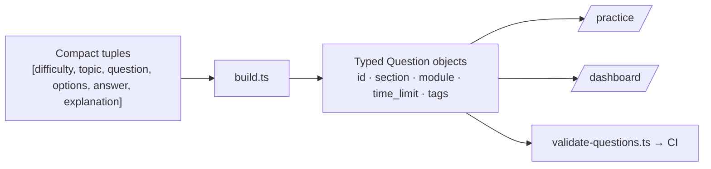

<h1 align="center">📝 MCQ — Placement Aptitude Practice</h1>

<p align="center"><b>Timed aptitude practice for campus placements: quantitative, logical and verbal, organised by the modules companies actually test.</b></p>

<p align="center">
  
  
  
  
</p>

<p align="center"><a href="https://mcq-r6wr.vercel.app"><b>Live demo →</b></a></p>

## What it does

- **Three sections, 42 modules:** Quantitative Aptitude (19), Logical Reasoning (14) and Verbal Ability (9), defined in `src/lib/curriculum.ts`.
- **210 hand-written questions** (95 quantitative, 70 logical, 45 verbal), each with four options, an explanation, a difficulty level and tags.
- **Difficulty-based timers:** 45 s easy, 75 s medium and 120 s hard.
- **Practice and dashboard pages** (`/practice`, `/dashboard`).
- **A question-bank validator** that catches duplicate IDs, duplicate question text, bad answer indexes and unknown sections or modules before anything ships.

## Tech stack

| Layer | Choice |
|---|---|
| Framework | Next.js 14 (App Router) + React 18 |
| Language | TypeScript |
| Styling | Tailwind CSS |
| Data | Typed question bank in `src/data/questions/*.ts` |
| Tooling | `tsx` validator script, Vitest, GitHub Actions |

## Project structure

```text
src/
  app/            # page.tsx (home), practice/, dashboard/
  lib/            # curriculum.ts (sections & modules), types.ts, config.ts
  data/questions/ # quantitative.ts, logical.ts, verbal.ts, build.ts (compact → typed)
scripts/
  validate-questions.ts
```



## Run locally

```bash
git clone https://github.com/nvaltryek-001/MCQ && cd MCQ
npm install
npm run validate   # check the question bank
npm run dev        # http://localhost:3000
```

Optional: copy `.env.example` to `.env.local` and add Supabase keys. The current pages work from the bundled question bank without them.

## Adding questions

Append a tuple to the right section file:

```ts
["m", "Percentages", "A price rises 20% then falls 20%. Net change?", ["0%", "-4%", "+4%", "-2%"], 1, "1.2 × 0.8 = 0.96 → 4% fall"]
```

Then run `npm run validate`; CI runs the same check on every push.

## Roadmap

- Persist attempts and scores per user (Supabase is already a dependency).
- Topic-wise accuracy charts on the dashboard.
